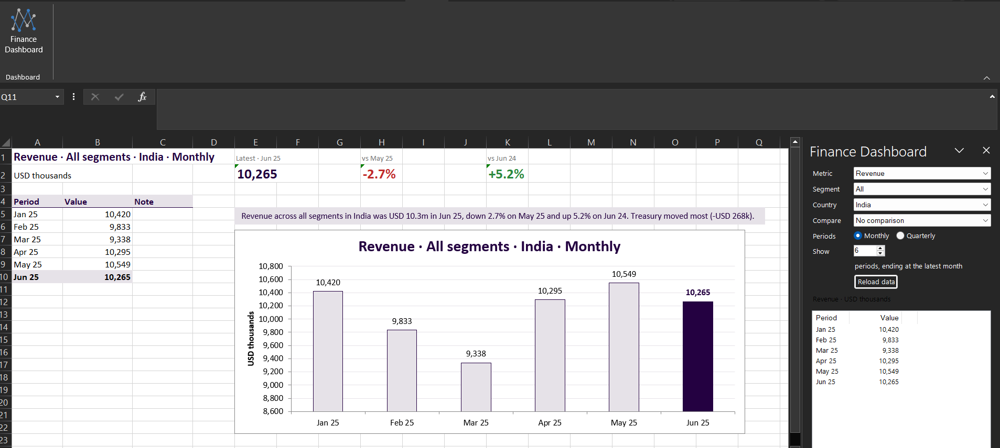
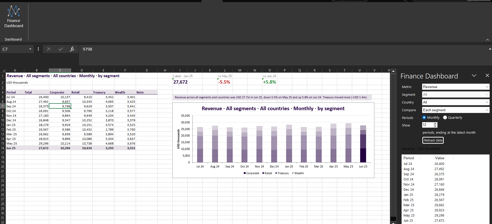
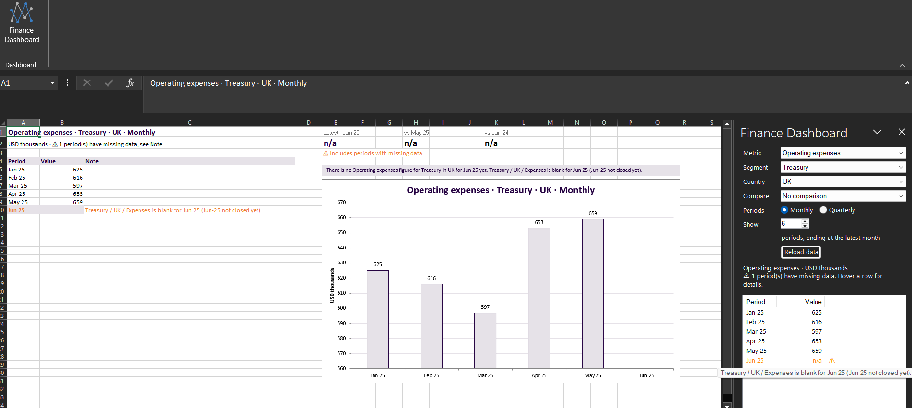

# Finance Dashboard Excel Add-in

An Excel add-in (C#, Excel-DNA) that lets a finance user chart the bank's monthly results and change what they see:
metric, business segment, country, monthly or quarterly periods, and how many periods. Every change redraws the
chart straight away.



## Features at a glance

- **Task pane** with the five choices, plus a **Compare** option (each segment or each country). There is no Apply
  button: every change recalculates.
- **Dashboard sheet:** a table of the numbers, three headline tiles and one chart built from the table.
  - Amounts are columns; Cost-to-income % is a line.
  - Comparing parts gives stacked columns that add up to the total, or one line per part plus the total for a ratio.
- **Headline tiles:** latest value, change on the previous period and change on the same period last year.
  Green means good news for that metric, so a fall in expenses is green. Percent metrics change in percentage points.
- **Missing data is visible:** periods built from blank cells are orange in the pane, table and chart, and the
  sheet's own note is quoted (for example "Jun-25 not closed yet").
- **Automatic commentary:** a plain-English summary above the chart, for example *"Revenue across all segments in
  India was USD 10.3m in Jun 25, down 2.7% on May 25…"*, including which segment moved most.
- **Heatmap:** every segment against every country for the latest period, shaded in the brand colours, to show
  where a metric is highest or lowest.
- **Worksheet functions:** `FIN.VALUE`, `FIN.SERIES` and `FIN.COMMENTARY` give the same numbers in any cell, using the
  same engine as the dashboard.
- **Brand colours and the latest period:** see "Requirements outside the brief's main text" below.

## Getting started

### 1. Prerequisites

| You need | Why | Get it |
|---|---|---|
| Windows 10 or 11 | Excel add-ins (`.xll`) run on Windows desktop Excel | |
| Desktop Excel: Microsoft 365, 2019 or 2016 | Hosts the add-in. Excel on the web and Mac are not supported | |
| Git | To clone the repository | <https://git-scm.com/download/win> |
| .NET SDK 8 or later | Builds the code and runs the tests | <https://dotnet.microsoft.com/download> |
| Visual Studio 2022 *(optional)* | Run and debug with F5. Choose the **.NET desktop development** workload | <https://visualstudio.microsoft.com/vs/community/> |

The add-in itself targets .NET Framework 4.8, which is built into Windows, so nothing extra has to be installed to
run it. To check the SDK is installed, open a Command Prompt and run `dotnet --list-sdks`.

### 2. Clone the repository

```cmd
git clone https://github.com/VivekKumartripathi/FinanceDashboard.git
cd FinanceDashboard
```

### 3. Build and run the tests

```cmd
dotnet build
dotnet test
```

Expect `Build succeeded` and `Passed! - Failed: 0, Passed: 124`. The tests include the brief's four worked examples
(E1-E4), run against the real `data/Financials.xlsx`.

### 4. Find out whether your Excel is 64-bit or 32-bit

In Excel go to **File → Account → About Excel**. The first line ends in **64-bit** or **32-bit**. Most current
installs are 64-bit. The build creates both versions in `src\FinanceDashboard.AddIn\bin\Debug\net48\`:

| Excel | Add-in file |
|---|---|
| 64-bit | `FinanceDashboard.AddIn-AddIn64.xll` |
| 32-bit | `FinanceDashboard.AddIn-AddIn.xll` |

### 5. Start Excel with the add-in

Close every Excel window first: Excel locks the add-in file while it is open, so a later build would fail.

**Option A: Visual Studio (recommended, lets you debug)**

1. Open `FinanceDashboard.sln`.
2. In Solution Explorer, right-click **FinanceDashboard.AddIn** and choose **Set as Startup Project**.
3. Press **F5**. Excel opens with the add-in loaded and a copy of `Financials.xlsx`.
   The launch settings assume Excel is installed at `C:\Program Files\Microsoft Office\root\Office16\EXCEL.EXE`
   and is 64-bit. If yours differs, edit `src\FinanceDashboard.AddIn\Properties\launchSettings.json`.
4. Press **Shift+F5** to stop; this also closes Excel.

**Option B: Command line (no Visual Studio)**

From the repository folder, for 64-bit Excel:

```cmd
cd src\FinanceDashboard.AddIn\bin\Debug\net48
start "" excel.exe /x "%CD%\FinanceDashboard.AddIn-AddIn64.xll" "%CD%\Financials.xlsx"
```

For 32-bit Excel, use `FinanceDashboard.AddIn-AddIn.xll` instead.

**Option C: Double-click**

Double-click the `.xll` that matches your Excel, then open `data\Financials.xlsx` (or any workbook that has
`Financials` and `Metrics` sheets). If Excel shows a security notice, choose **Enable this add-in for this session
only**.

Excel opens a **copy** of the workbook from the build folder, so the original in `data\` is never changed, even if
you save.

### 6. Use the dashboard

See the [User guide](#user-guide) below. In short: **Finance** tab → **Finance Dashboard**, make your choices in the
pane, and look at the **Dashboard** sheet.

### 7. Troubleshooting

| Problem | Fix |
|---|---|
| No **Finance** tab in the ribbon | Excel was not started with the add-in. Use one of the options in step 5. Check the `.xll` matches your Excel's bitness |
| Build fails with "file is in use" / "cannot copy" | Close every Excel window and build again |
| "Sorry, we couldn't find Financials.xlsx" on F5 | The build copies `data\Financials.xlsx` next to the add-in. Check that file exists, then build again |
| Excel says the file is not a valid add-in | You opened the wrong bitness. Use the other `.xll` |
| The pane shows a red message | The active workbook has no `Financials` or `Metrics` sheet. Open `Financials.xlsx` and click **Reload data** |
| Security notice blocks the add-in | Choose **Enable this add-in for this session only**, or add the `bin\Debug\net48` folder under **File → Options → Trust Center → Trust Center Settings → Trusted Locations** |

## User guide

### Open the dashboard

1. With Excel running and the add-in loaded (see Getting started), look at the ribbon at the top of Excel.
   Click the **Finance** tab, at the right-hand end after **Help**.
2. Click **Finance Dashboard**. The **Finance Dashboard pane** opens on the right of the window.
3. Click the **Dashboard** sheet tab at the bottom of the workbook. The table, headline tiles and chart are drawn
   there, and they redraw every time you change a choice in the pane.

To close the pane, click the **×** at its top right. Click **Finance Dashboard** again to bring it back; your
choices are kept.

### The pane

```
Metric    [ Revenue              ▼ ]   what to measure
Segment   [ All                  ▼ ]   one business segment, or All
Country   [ All                  ▼ ]   one country, or All
Compare   [ No comparison        ▼ ]   split the chart by segment or by country
Periods   (•) Monthly  ( ) Quarterly
Show      [ 12 ▲▼ ] periods, ending at the latest month
          [ Reload data ]
Revenue · USD thousands                 what is shown, and any data warnings
Period    Value      ⚠                 the numbers behind the chart
```

| Control | What it does |
|---|---|
| **Metric** | Loans outstanding, Revenue, Operating expenses or Cost-to-income %. Names and units come from the Metrics sheet |
| **Segment** | Corporate, Retail, Treasury, Wealth, or **All** (every segment added together) |
| **Country** | India, UK, USA, or **All** (every country added together) |
| **Compare** | **Each segment** or **Each country** draws one series per segment or country. The matching filter above is greyed out because it no longer applies |
| **Monthly / Quarterly** | Months, or calendar quarters (Jan-Mar, Apr-Jun, Jul-Sep, Oct-Dec) |
| **Show N periods** | How many months or quarters to show. The chart always ends at the latest month in the data. The maximum is all the data: 30 months or 10 quarters |
| **Reload data** | Reads the Financials and Metrics sheets again. Use it after editing them or switching workbook |
| **Number table** | The exact value for each period. Rows marked ⚠ in orange have missing data: hover over the row to see why |

The segment, country and metric lists are read from the data, so new rows appear without any code change.

### The Dashboard sheet

```
 A                    B          C                 E                  H               K
 Revenue · All segments · All countries · Monthly  Latest · Jun 25    vs May 25       vs Jun 24
 USD thousands                                     31,402             -1.2%           +4.5%
                                                   ⚠ Includes periods with missing data
 Period   Value      Note                          ┌──────────────── chart ────────────────┐
 Jul 24   30,118                                   │                                       │
 ...                                               │      ▒ ▒ ▒ ▒ ▒ ▒ ▒ ▒ ▒ ▒ ▒ █          │
 Jun 25   31,402                                   └───────────────────────────────────────┘
```
*(The numbers above are only an illustration.)*

**1. Title and table (left)**

- The title describes exactly what is shown.
- The table lists every period. The chart is built from these cells, so the chart and table always agree and the
  numbers can be copied.
- The **latest period** row is bold. Orange rows have missing data, explained in the **Note** column.

**2. Headline tiles (top right)**

| Tile | Meaning |
|---|---|
| **Latest** | The value for the latest month or quarter |
| **vs previous** | Change on the period before (May 25, or Q1 25 when quarterly) |
| **vs last year** | Change on the same period a year earlier (Jun 24, or Q2 24), even if fewer periods are on the chart |

- **Green means good news and red means bad news for that metric.** Revenue going up is green; Operating expenses or
  Cost-to-income % going up is red.
- Amounts change in **%**. Cost-to-income % changes in **percentage points (pp)**: 36.5% → 37.4% is **+0.9 pp**.
- *⚠ Includes periods with missing data* means one of the compared periods is incomplete, so treat the change with
  care.

**3. Chart (below the tiles)**

- **Amounts** are columns. **Cost-to-income %** is a line.
- The **latest period is dark** (brand colour #240141) and always labelled; earlier periods are light (#E6E2E8).
- With 12 periods or fewer, every point is labelled.
- A bar with an **orange outline** has missing data. A **gap** means there is no data at all for that period.
- **Compare → Each segment / Each country:**
  - Amounts become **stacked columns**, one shade per part, so you see each part and the total together.
  - Cost-to-income % shows one line per part plus the overall figure as a **bold dashed line**.
  - Earlier periods are faded so the latest column stands out.



**4. Commentary (above the chart)**

A short summary that rewrites itself with every change. It gives:

- the latest value, in USD millions or thousands (the data is in USD thousands);
- the change on the previous period and on last year, with *(better)* or *(worse)* for expenses and cost-to-income;
- which segment or country moved most since the previous period;
- whether the latest period is the highest or lowest shown;
- any missing data, quoting the sheet's note.

The text box sits on top of the chart, so copying both into a report keeps the commentary with the chart.

**5. Heatmap (below the chart)**

A grid of every segment against every country for the **latest** month or quarter, with totals. It answers
"where?", which the trend chart cannot: for example, which segment and country has the highest cost-to-income.

- Cells are shaded from light to dark brand colour: **darker = higher**. Totals are bold and not shaded.
- It follows the chosen **metric** and **Monthly / Quarterly**, but always shows every segment and country, whatever
  the Segment and Country filters say.
- Every cell is calculated exactly as the dashboard would for that segment and country, so the cost-to-income totals
  follow the same rules as E3 and E4.
- A cell with missing data has an **orange border**; one with no value at all shows **⚠ n/a**.

### Worksheet functions

The same numbers can be used in any cell, so analysts can build them into their own models. Type `=FIN.` in a cell
to see the functions, or find them under **Insert Function → Finance Dashboard**.

| Function | Returns | Example |
|---|---|---|
| `FIN.VALUE(metric, segment, country, period)` | One value | `=FIN.VALUE("Loans", "Retail", "All", "Q2 25")` → 453,406 (E1) |
| `FIN.SERIES(metric, segment, country, [frequency], [periods])` | Period and value columns that spill down | `=FIN.SERIES("CostToIncome", "All", "India", "Q", 4)` → E4 |
| `FIN.COMMENTARY(metric, segment, country, [frequency], [periods])` | The commentary sentence | `=FIN.COMMENTARY("Revenue", "All", "India", "M", 6)` |

- **metric:** a code (`Loans`, `Revenue`, `Expenses`, `CostToIncome`) or a display name (`"Cost-to-income %"`).
- **segment / country:** a name, or `"All"`. Cell references work too, for example `=FIN.VALUE(A2, B2, C2, D2)`.
- **period:** `"Jun 25"`, `"June 2025"`, `"2025M06"`, `"Q2 25"` or `"2025Q2"`. A quarter gives the quarterly figure.
- **frequency:** `"M"` (monthly, default) or `"Q"` (quarterly). **periods:** default 12.
- **Missing data returns `#N/A`**, never zero, so it shows as a gap in charts. Bad arguments return `#VALUE!`.
- The functions read the workbook the formula is in. When the Financials or Metrics sheet is edited, every
  `FIN.` formula recalculates by itself.

### Missing data

Two cells in the data are blank, each with a note in the Financials sheet:

| Cell | Note | Where you see ⚠ |
|---|---|---|
| Treasury / UK / Expenses, Jun 25 | Jun-25 not closed yet | Operating expenses and Cost-to-income % for Jun 25 or Q2 25, when the selection includes Treasury and UK |
| Wealth / India / Revenue, Feb 24 | Feb-24 awaiting restatement | Revenue and Cost-to-income % for Feb 24 or Q1 24, when the selection includes Wealth and India |



A blank is never counted as zero. Totals use the cells that have values and are flagged; Cost-to-income % leaves the
blank month out of both expenses and revenue. See [Blank cells](#blank-cells) for the reasoning.

### Walkthroughs: the brief's worked examples

| Example | Metric | Segment | Country | Periods | Show | Expected |
|---|---|---|---|---|---|---|
| E1 | Loans outstanding | Retail | All | Quarterly | 4 | 424,204 · 437,325 · 448,003 · 453,406 |
| E2 | Revenue | All | India | Monthly | 6 | 10,420 · 9,833 · 9,338 · 10,295 · 10,549 · 10,265 |
| E3 | Cost-to-income % | Treasury | India | Quarterly | 4 | 39.0% · 31.2% · 36.5% · 37.4% |
| E4 | Cost-to-income % | All | India | Quarterly | 4 | 57.0% · 56.4% · 57.5% · 56.3% |

Leave **Compare** on *No comparison*. For a view of E3 and E4 together, choose E4's settings with
**Compare → Each segment**: the dashed line is E4 and the Treasury line is E3.

### More things to try

- **Which segment drives revenue?** Revenue · All · All · Monthly · 12 · Compare: Each segment.
- **Is the cost base growing?** Operating expenses · All · All · Quarterly · 10. Watch the vs-last-year tile.
- **How do countries compare on efficiency?** Cost-to-income % · All · All · Quarterly · 8 · Compare: Each country.
- **Where are costs highest relative to income?** Cost-to-income % · Quarterly, then look at the heatmap below the
  chart. The darkest cell is the least efficient segment and country.
- **See a missing month:** Operating expenses · Treasury · UK · Monthly · 6. Jun 25 is a gap; hover over its row in
  the pane, and read the commentary.
- **Check E2 with a formula:** in an empty cell on any sheet, type `=FIN.SERIES("Revenue", "All", "India", "M", 6)`.

## Project structure

```
src/FinanceDashboard.Core      All parsing and calculation. No Excel code; netstandard2.0.
  Model/                       Period, FinancialRecord, MetricInfo, Selection, SeriesResult
  Parsing/                     Turns sheet cells (object[,]) into the model
  Calculation/                 SeriesCalculator, KpiCalculator, DashboardCalculator, CommentaryWriter,
                               HeatmapCalculator, AggregationRules
src/FinanceDashboard.AddIn     Excel-DNA add-in: ribbon, task pane, FIN.* functions, reading the workbook, drawing the dashboard
tests/FinanceDashboard.Tests   xUnit tests for Core, including E1-E4 against data/Financials.xlsx
```

The add-in reads each sheet with one `Range.Value2` call and passes the plain array to Core. Keeping Core free of
Excel means the calculations are fast to test and the same engine could be used anywhere.

## How the numbers are calculated

| Rule | Decision | Why |
|---|---|---|
| Periods | Always end at the latest month; last N months, or last N calendar quarters | As the brief says |
| Segment / country | Only matching rows; "All" means no filter | As the brief says |
| Quarterly Revenue, Expenses | Sum of the three months | Flows add up over time |
| Quarterly Loans | Balance at the last month of the quarter | A balance is a point in time; summing three month-end balances would triple-count. E1 confirms it |
| Cost-to-income %, one segment | Expenses ÷ Revenue over the period | E3 |
| Cost-to-income %, All segments | Simple average of each segment's ratio | The only rule that gives E4 (see below) |
| Cost-to-income %, All countries | Countries added together within a segment before the ratio | Not covered by an example; only segments are averaged, as in E4 |
| Money | `decimal`, never `double` | No binary rounding errors |
| Columns | Found by header name; month columns by the pattern `2023M01` | The Notes column is ignored and new months are picked up automatically |

### Blank cells

The data has two blank cells, each explained in the Notes column: Treasury / UK / Expenses for Jun 25
("Jun-25 not closed yet") and Wealth / India / Revenue for Feb 24 ("Feb-24 awaiting restatement").

A blank is **never treated as zero**, because a month that has not closed would look like a very cheap month.

- **Amounts:** use the cells that have values and flag the period. If every cell is blank, the period has no value
  and shows as a gap.
- **Balances:** only the quarter-end month matters, so a blank earlier in the quarter does not affect the value.
- **Ratios:** a month that is blank on either side is left out of both sides. Two months of expenses over two months
  of revenue is a fair estimate; two months over three is not.
- If the data ever ends mid-quarter, the last quarter is kept (the chart still ends at the latest month) and flagged
  as covering only one or two months.

None of the worked examples touch a blank cell, so all four still match exactly.

## Things in the brief that were unclear or wrong

1. **E4 averages segment ratios.** Total India expenses ÷ total India revenue gives 53.3% for Q3 24, but the brief
   expects 57.0%. Only a simple average of the four segments' ratios gives 57.0 / 56.4 / 57.5 / 56.3. I matched the
   examples because the brief says the add-in must, but a finance user would usually expect the total-based figure:
   the simple average gives a small segment the same weight as Retail. This is worth confirming with the finance team.
2. **Loans vs. flows.** The Metrics sheet does not say which metrics are balances. I treated Loans as a balance
   (quarter-end value), which E1 confirms, and kept the rule in one place (`AggregationRules`).
3. **Cost-to-income for All countries** is not covered by any example. My rule is described in the table above.
4. **Blank cells and partial quarters** were left to me; see above.

## Requirements outside the brief's main text

- **Brand colours.** The footer of the brief says reports use **#240141** and **#E6E2E8**. The chart uses the light
  colour for earlier periods and the dark colour for the latest one; titles and table headers use both. Comparison
  series use shades between the two. Green/red on the headline tiles and orange for missing data are kept because
  they carry meaning.
- **CFO note.** A text box on the Dashboard sheet asks for the latest period to stand out. The latest bar or point is
  dark and always labelled, earlier periods are lighter or faded, and the latest table row is bold. The text box sat
  where the dashboard is drawn, so the add-in hides it (it is not deleted).
- **The data is never changed.** The add-in only reads Financials and Metrics and only writes to Dashboard.

## Testing

- **Worked examples E1-E4** run against the real workbook, read with ClosedXML through the same parser the add-in
  uses. They were committed failing first and then made to pass one step at a time (see the commit history).
- **Rules on small hand-made data,** so each expected number can be checked by eye: filtering, monthly and
  quarterly roll-ups, partial quarters, cost-to-income, blank cells, headline numbers, and breakdowns adding up to
  their total.
- **Parser tests** use 1-based arrays, the same shape Excel returns.
- The Excel side (ribbon, pane, chart) was tested by hand in Excel; it contains no calculation logic.

## How I used AI

I used **Claude Code** as a coding assistant for analysing the brief and data, generating code and tests, and
debugging. My workflow:

- Work in small steps, one commit per step, in the order shown in the history.
- Define correctness first: the worked examples were committed as failing tests before the engine existed.
- Review each change, run `dotnet test`, and test the add-in in Excel before committing.
- Treat its output as a draft: check the numbers against the brief, and question anything unclear (for example the
  ⚠ warnings and the colour codes, which led to the requirements outside the brief's main text).

The decisions and trade-offs are documented in the sections above, and I can walk through any part of the code.

## Limitations and next steps

- The dashboard redraws the whole Dashboard sheet, so anything else typed there is cleared.
- The add-in uses the active workbook; with several data workbooks open, click **Reload data** after switching.
- `FIN.SERIES` spills into neighbouring cells, which needs Excel 365 or 2021. Older versions need it entered as an
  array formula.
- Possible next steps: a "what drove the change" variance view and copying the chart to PowerPoint in one click.
